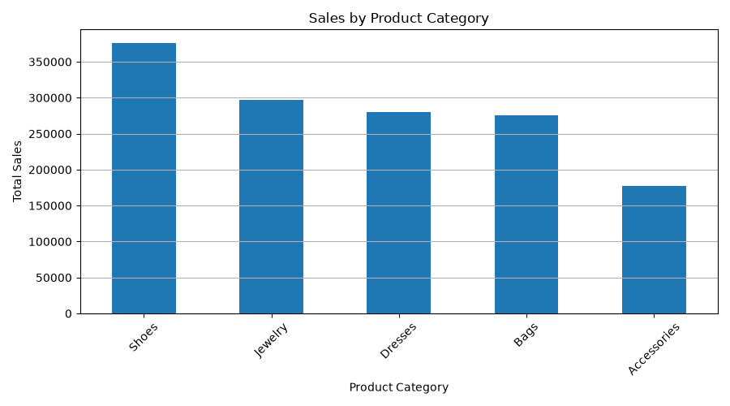

# Exploratory Data Analysis and SQL Business Questions Report

## 1. Project Overview

This project analyses synthetic boutique transaction data to understand sales performance, product categories, and customer spending patterns.

## 2. Dataset Overview

- Total transactions: 150
- Total columns: 5
- Date range: January to October 2026
- Missing values: 0

The dataset contains transaction dates, transaction IDs, amounts, product categories, and customer IDs.

## 3. Data Quality Analysis

The dataset was checked for missing values and statistical information. No missing values were found.

- Average transaction amount: 9,370.74
- Minimum transaction amount: 509
- Maximum transaction amount: 120,000

## 4. SQL Business Questions and Findings

### Question 1: What are the monthly sales?

February had the highest sales, with 355,493. March had the lowest sales, with 73,951.

### Question 2: Which product categories generate the most sales?

Shoes generated the highest sales, with 376,037. Accessories generated the lowest sales, with 177,421.

### Question 3: What is the average spending per customer?

Customer C040 had the highest average transaction amount, approximately 47,874.33. Customer C020 had the lowest average, 628.

## 5. Conclusion

The analysis shows that sales vary across months and product categories. Shoes are the strongest category by total sales, while February was the strongest month. Customer spending also varies considerably.

These findings can help the boutique understand its sales patterns and customer purchasing behaviour.