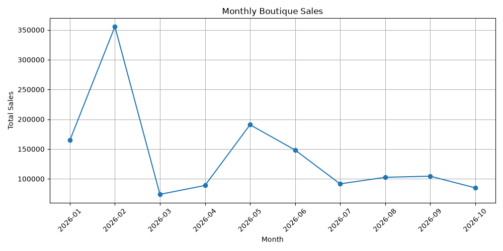
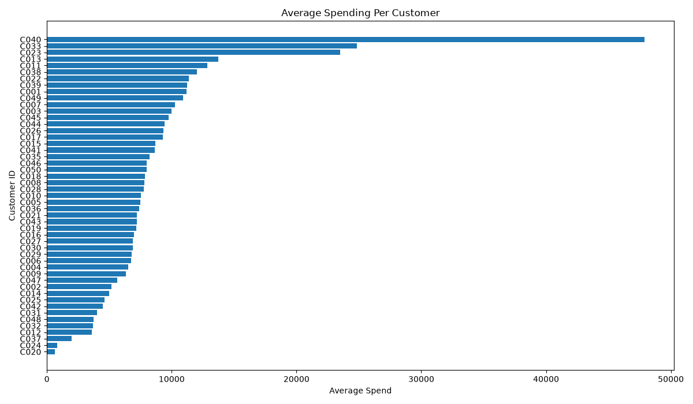

# Exploratory Data Analysis and SQL Business Questions Report

## 1. Project Overview

This project analyses boutique transaction data to understand monthly sales, product category performance, and customer spending patterns.

## 2. Dataset Overview

- Total transactions: 150
- Total columns: 5
- Date range: January to October 2026
- Missing values: 0

## 3. Data Quality Analysis

The dataset was checked for missing values and statistical information.

- Average transaction amount: 9,370.74
- Minimum transaction amount: 509
- Maximum transaction amount: 120,000

## 4. SQL Business Questions and Results

### Question 1: What are the monthly sales?

**SQL Query Result:**

| Month | Total Sales |
|---|---:|
| 2026-01 | 164670 |
| 2026-02 | 355493 |
| 2026-03 | 73951 |
| 2026-04 | 88827 |
| 2026-05 | 190787 |
| 2026-06 | 148422 |
| 2026-07 | 91549 |
| 2026-08 | 102544 |
| 2026-09 | 104454 |
| 2026-10 | 84914 |

February had the highest monthly sales, while March had the lowest.

### Question 2: Which product categories generate the most sales?

**SQL Query Result:**

| Category | Total Sales |
|---|---:|
| Shoes | 376037 |
| Jewelry | 296818 |
| Dresses | 280172 |
| Bags | 275163 |
| Accessories | 177421 |

Shoes generated the highest sales, while Accessories generated the lowest.

### Question 3: What is the average spending per customer?

**SQL Query Result:**

| Customer ID | Average Spend | Transactions |
|---|---:|---:|
| C040 | 47874.33 | 3 |
| C033 | 24855.40 | 5 |
| C023 | 23505.25 | 4 |
| C013 | 13730.00 | 1 |
| C011 | 12846.00 | 1 |
| C038 | 12003.50 | 2 |
| C022 | 11376.00 | 1 |
| C039 | 11218.00 | 3 |
| C001 | 11184.00 | 1 |
| C049 | 10930.00 | 2 |
| C007 | 10246.25 | 4 |
| C003 | 10009.67 | 3 |
| C045 | 9761.00 | 3 |
| C044 | 9446.67 | 3 |
| C026 | 9360.00 | 5 |
| C017 | 9273.00 | 3 |
| C015 | 8702.17 | 6 |
| C041 | 8657.00 | 5 |
| C035 | 8207.00 | 7 |
| C046 | 7989.00 | 3 |
| C050 | 7979.75 | 4 |
| C018 | 7859.00 | 1 |
| C008 | 7807.00 | 2 |
| C028 | 7749.17 | 6 |
| C010 | 7518.40 | 5 |
| C005 | 7502.00 | 4 |
| C036 | 7417.25 | 4 |
| C021 | 7231.67 | 3 |
| C043 | 7203.43 | 7 |
| C019 | 7165.00 | 2 |
| C016 | 6991.17 | 6 |
| C027 | 6899.33 | 3 |
| C030 | 6896.00 | 1 |
| C029 | 6774.67 | 3 |
| C006 | 6731.00 | 2 |
| C004 | 6515.00 | 2 |
| C009 | 6322.20 | 5 |
| C047 | 5652.67 | 3 |
| C002 | 5164.00 | 2 |
| C014 | 5009.50 | 4 |
| C025 | 4640.67 | 3 |
| C042 | 4497.00 | 1 |
| C031 | 4012.00 | 2 |
| C048 | 3746.33 | 3 |
| C032 | 3685.00 | 1 |
| C012 | 3587.00 | 2 |
| C037 | 1989.00 | 2 |
| C024 | 819.00 | 1 |
| C020 | 628.00 | 1 |

Customer C040 had the highest average spending, while C020 had the lowest.

## 5. Conclusion

The analysis shows that sales vary across months and product categories. February was the strongest month, and Shoes generated the highest category sales. Customer spending also varied considerably.

These findings can help the boutique understand its sales patterns and customer purchasing behaviour.
## 3. Data Quality Analysis

The dataset was checked for missing values and statistical information. No missing values were found.

- Average transaction amount: 9,370.74
- Minimum transaction amount: 509
- Maximum transaction amount: 120,000

## 4. SQL Business Questions and Findings

### Question 1: What are the monthly sales?

February had the highest sales, with 355,493. March had the lowest sales, with 73,951.

### Question 2: Which product categories generate the most sales?

Shoes generated the highest sales, with 376,037. Accessories generated the lowest sales, with 177,421.

### Question 3: What is the average spending per customer?

Customer C040 had the highest average transaction amount, approximately 47,874.33. Customer C020 had the lowest average, 628.

## 5. Conclusion

The analysis shows that sales vary across months and product categories. Shoes are the strongest category by total sales, while February was the strongest month. Customer spending also varies considerably.

These findings can help the boutique understand its sales patterns and customer purchasing behaviour.